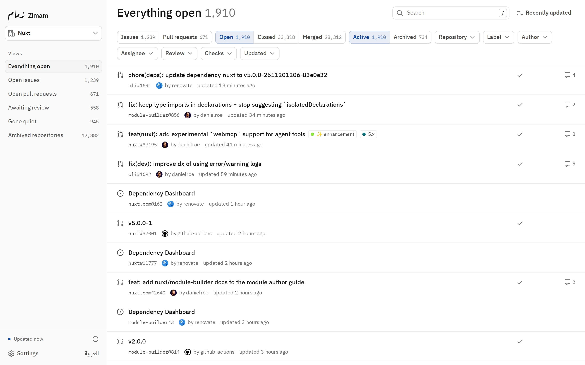

# Zimam

Every issue and pull request across your GitHub organizations, in one fast, filterable list.

**[zimam.ieasybooks.com](https://zimam.ieasybooks.com)** · Arabic and English

[](https://github.com/ieasybooks/zimam/actions/workflows/ci.yml)

<picture>
  <source media="(prefers-color-scheme: dark)" srcset="docs/screenshot-dark.webp">
  
</picture>

## Features

- **One list across sources.** A workspace mixes organizations, user accounts and single repositories. An account brings all its repositories, new ones included, or only those you pick. Keep as many workspaces as you like.
- **Faceted filters with live counts.** Type, state, active or archived repository, account, repository, label, author, assignee, what involves you, review, checks, conflicts and last activity. Each value shows how many items picking it would give.
- **Typed filters.** The search box takes qualifiers like `author:name`, `label:bug,docs`, `repo:name`, `is:draft` and `no:assignee`, and a minus before one leaves its matches out: `-author:renovate`.
- **Pull requests at a glance.** Each open pull request shows its checks, whether a review is required, approved or asked to change, whether it conflicts with its base branch, and its size. Its checks icon opens the list of checks with links to their logs. Sorting by "Ready to merge" puts approved, passing pull requests first.
- **What involves you.** Pull requests that ask you or your team for a review, and what you opened or are assigned to.
- **Repositories page.** Every repository in the workspace with its open issues and pull requests, those awaiting a required review, failing checks or conflicting, its last activity, and bars of what was opened each week over six months. Each count opens the list it counts. Pin the repositories you watch to keep them on top, in the order you drag them into, whatever the sort.
- **Views are URLs.** Save filter sets in the sidebar; every screen is a link you can share or bookmark.
- **Near-live.** Changes appear within a minute while the tab is open, and the rows that changed are marked.
- **Fast.** Opens from a local cache in under a second and scrolls thousands of rows with virtual rendering.
- **Installable.** Install it as an app on a computer or phone. It opens without a network and shows what was saved.
- **Arabic and English.** Right-to-left layout, Arabic plural forms, and search that folds Arabic spelling variants (hamza, tā' marbūṭa, diacritics).
- Light and dark themes, comfortable or compact rows.

## How it works

Zimam is a static single-page app with no backend: the browser calls GitHub's GraphQL API directly, with the token you give it.

- **First load.** Open issues and pull requests load first, per repository, four at a time. The closed history then loads in the background, in 45-second slices with a check for changes before each one, and resumes where it stopped. Each page holds as many items as still cost one point: 74 issues, or 49 open pull requests with their checks.
- **Updates.** Every minute, one search query per eight sources finds everything updated since the last check (`updated:>=`, with a 10-minute overlap for the search index's lag). Rows that changed are marked for a few seconds. An account with only some repositories picked is still searched as a whole, and changes elsewhere in it are dropped; the repositories it leaves out are never read.
- **Quiet minutes are free.** When the last search found nothing, Zimam first asks GitHub's REST API for each source's most recently updated issue, with the ETag of its last answer. An unchanged answer costs nothing, and when every source is unchanged the search is skipped. It still runs at least every 5 minutes. Organizations use one address for all their repositories when the token may read it, and each active repository otherwise.
- **What search can't see.** A finished CI run doesn't change a pull request's `updatedAt`, and neither does its base branch moving on, so the checks, reviews and conflicts of open pull requests in active repositories are read again on their own, 50 at a time: every minute while checks run, every 5 minutes while they fail, every 15 otherwise. Review requests can go to a team, so a search for `review-requested:@me` finds them every 5 minutes. Deleted and transferred items are caught by refetching the open items every 6 hours, and only what GitHub reports as gone is removed.
- **Rate limits.** GitHub's hourly allowance is shared by every tool on your account. Zimam leaves 2% of it for the others, loads history only while more than 15% remains, and pauses until the reset time GitHub reports. When GitHub asks for a pause without a time, each pause in a row doubles, from 30 seconds up to 15 minutes. A request with no answer after 30 seconds is given up on.
- **Offline.** A service worker keeps the app's own files, never GitHub's responses, so the app opens without a network and shows the cached list. Syncing resumes as soon as the connection is back. A new version waits until you reload.
- **Storage.** Each workspace's items are cached in IndexedDB, settings and views in `localStorage`. With several tabs open, one tab syncs (Web Locks) and the others pick up its cache (BroadcastChannel).
- **Filtering** is one pass over the cached items, so results and counts update as you click. Filters live in the URL's query string.

## Security

- Your token stays in your browser's storage and is sent only to `api.github.com`.
- A Content Security Policy enforces it: the page can connect only to GitHub's API and Cloudflare Web Analytics, and load images only from GitHub's avatar host.
- Settings exports leave tokens out.

## Tokens

Read access is enough. Each workspace keeps its own token.

| Token                                                                                                                                                                                                    | Reaches                                   | Permissions                                                      |
| -------------------------------------------------------------------------------------------------------------------------------------------------------------------------------------------------------- | ----------------------------------------- | ---------------------------------------------------------------- |
| [Fine-grained](https://github.com/settings/personal-access-tokens/new?name=Zimam&description=Read-only+access+for+Zimam&expires_in=90&issues=read&pull_requests=read&metadata=read&commit_statuses=read) | One organization or account, as its owner | Issues, pull requests, metadata and commit statuses: read-only   |
| [Classic](https://github.com/settings/tokens/new?scopes=repo,read:org&description=Zimam)                                                                                                                 | Every organization you belong to          | `repo` and `read:org` (without `repo`, public repositories only) |

## Stack

Vue 3, Nuxt UI, vue-i18n, TanStack Virtual, Vite, Bun, Vitest, oxlint and oxfmt. Hosted as static assets on Cloudflare Workers.

## Development

```sh
mise install     # pinned Bun and Node
bun install
mise dev         # http://127.0.0.1:5190
mise check       # format, lint and types
mise test        # unit tests
```

In development, the setup screen can use your `gh` CLI's token, so there is nothing to paste.

`main` deploys to Cloudflare Workers from GitHub Actions once its checks pass.

## The name

Zimam (زمام) means "reins". In 162 AH (778–79 CE), the Abbasid caliph al-Mahdī created the Dīwān al-Zimām, the office that oversaw all the others.
